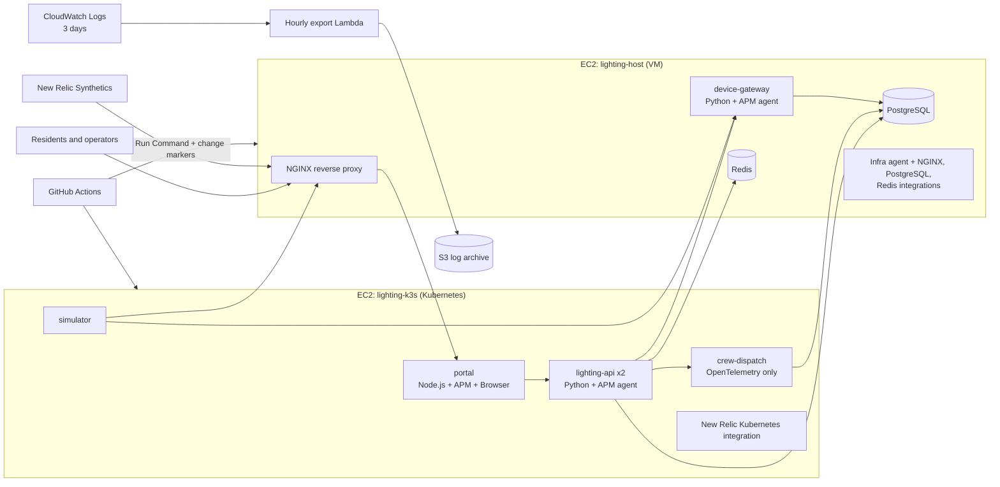

# Larkspur Ridge Smart Lighting: a New Relic observability demo

The City of Larkspur Ridge, Tennessee (a fictional city) runs a Smart Lighting program: 48 connected LED streetlights and 12 traffic signals across four districts. Operators send commands (turn on at dusk, dim, switch a signal to flash mode), the field network relays them, and each device acknowledges. The city's SRE and web teams want to know when a light is taking too long to respond, or when anything in the stack is degrading, before residents start calling 311.

This repository builds that system on AWS and instruments every layer with New Relic. Everything is code: two Terraform projects, a GitHub Actions pipeline, and bootstrap scripts.

> Fictional city for a monitoring demonstration. Not affiliated with any state or local agency.

## Architecture



| Layer | Component | Runs on | New Relic instrumentation |
|---|---|---|---|
| Front end | portal (Node.js, Express) | Kubernetes | APM agent, Browser agent (injected by APM) |
| Back end | lighting-api (Python, FastAPI), 2 replicas | Kubernetes | APM agent, custom attributes |
| Field network | device-gateway (Python) | VM, systemd | APM agent, custom events `LightCommand` and `LightingCheckIn` |
| Work orders | crew-dispatch (Python) | Kubernetes | OpenTelemetry only: auto + custom span + custom metric |
| Reverse proxy | NGINX | VM | Infrastructure agent, NGINX integration, log forwarding |
| Database | PostgreSQL 16, 15.5 million readings | VM | PostgreSQL integration, slow SQL traces, slow-statement log |
| Cache | Redis | VM | Redis integration |
| Platform | k3s | EC2 | Kubernetes integration (nri-bundle) with metadata injection |
| Cloud | EC2, EBS, S3, Lambda | AWS | AWS integration (API polling) |
| Outside-in | Ping monitor (scripted monitors need a paid plan) | New Relic | Synthetics |
| Delivery | GitHub Actions | GitHub | Change tracking markers |

## The four demo incidents

| Incident | How to trigger | What New Relic shows | Alert that fires |
|---|---|---|---|
| **Gateway lag** (the headline) | `./scripts/demo.sh gateway-lag RV` | Riverside commands take 4 to 8 s while every service returns 200; ack time by district spikes; the light-command SLO burns | Light commands slow, SLO burn rate (response-time alerts stay quiet because commands are excluded from them, which is the point) |
| **Slow query** | `./scripts/demo.sh slow-query on` | Device-history requests jump from milliseconds to seconds; slow SQL trace with obfuscated statement; PostgreSQL log line; sequential scans climb | Slow database queries |
| **Timeout errors** | `./scripts/demo.sh dispatch-timeout on` | `ReadTimeout` in Errors Inbox; 504s; the trace shows lighting-api waiting 3 s on crew-dispatch, then giving up | Timeout errors, error rate |
| **Bad release** | Edit `services/lighting-api/release.json` to `"version": "1.1.0", "statusCache": false`, commit, push | A change marker appears; `/api/devices` response time climbs right after it; traces show 60 identical queries (N+1); Redis hit rate drops | Response time |

Reset with `./scripts/demo.sh all-off`, and revert the release with a second commit (`"version": "1.1.1", "statusCache": true`), which records its own marker.

## Build it

All commands run on your Ubuntu workstation VM. Each block says what it does.

### 0. Prerequisites

- AWS CLI v2 signed in to your account (`aws sts get-caller-identity` should print your account).
- Terraform 1.6 or later, `jq`, and the GitHub CLI `gh`.
- New Relic account 8656494 with two keys from **API keys** in the New Relic UI:
  - an **INGEST - LICENSE** key (40 characters, ends in `NRAL`): the agents use it to send data
  - a **USER** key (starts with `NRAK-`): Terraform and GitHub Actions use it to configure New Relic

### 1. Publish the repository

The EC2 instances clone this repository at boot, so it must be on GitHub (public) before the AWS build.

```bash
cd ~/smart-lighting-demo
git init -b main && git add . && git commit -m "Larkspur Ridge Smart Lighting demo"
gh repo create ptokito/smart-lighting-demo --public --source . --push
```
- `git init -b main` starts a repository on a branch named main.
- `gh repo create ... --push` creates the GitHub repository and uploads this commit.

### 2. Build the AWS environment

```bash
cd infra/aws
cp terraform.tfvars.example terraform.tfvars
export TF_VAR_newrelic_license_key='PASTE_THE_40_CHARACTER_LICENSE_KEY'
terraform init
terraform plan -out aws.plan
terraform apply aws.plan
```
- `export TF_VAR_...` hands the key to Terraform without writing it to a file. Terraform checks it is exactly 40 characters.
- `terraform plan` lists everything it will create (about 45 resources) without creating anything; `apply` builds it.
- If the plan says the GitHub OIDC provider already exists, set `create_github_oidc_provider = false` in `terraform.tfvars` and plan again.

Terraform finishes in about 2 minutes, but the instances keep configuring themselves for another **10 to 15 minutes** (package installs, loading 15.5 million rows, building images). Follow along:

```bash
$(terraform output -raw connect_host)
sudo tail -f /var/log/smart-lighting-bootstrap.log
```
- The first line opens a shell on the host VM through Session Manager (no SSH key needed).
- The log ends with `Host bootstrap complete`. Do the same with `connect_k3s` for the Kubernetes node (`k3s bootstrap complete`). Type `exit` to leave.

### 3. Smoke test

```bash
cd ~/smart-lighting-demo && ./scripts/smoke-test.sh
```
Six `PASS` lines mean every hop works: NGINX, portal, lighting-api, device-gateway and crew-dispatch. Open the `portal_url` output in a browser to click around (that real browser session is what fills the Browser agent's data).

### 4. Configure New Relic (after about 10 minutes of data)

```bash
cd ~/smart-lighting-demo/infra/newrelic
cp terraform.tfvars.example terraform.tfvars
sed -i "s|http://203.0.113.10|$(terraform -chdir=../aws output -raw portal_url)|" terraform.tfvars
nano terraform.tfvars        # set alert_email
export NEW_RELIC_API_KEY='NRAK-PASTE_YOUR_USER_KEY'
terraform init
terraform plan -out nr.plan
terraform apply nr.plan
```
- The `sed` line copies the portal URL from the AWS build into this project's settings.
- This creates the AWS integration, 3 service levels, the alert policy with 11 conditions and email routing, 2 Synthetics monitors and the dashboard. The `dashboard_url` output opens it.
- If the plan fails with "no entities found", the agents have not reported yet; wait a few minutes.

### 5. Connect GitHub Actions

```bash
cd ~/smart-lighting-demo
gh variable set AWS_REGION --body "$(terraform -chdir=infra/aws output -raw aws_region)"
gh variable set AWS_DEPLOY_ROLE_ARN --body "$(terraform -chdir=infra/aws output -raw github_deploy_role_arn)"
gh variable set HOST_INSTANCE_ID --body "$(terraform -chdir=infra/aws output -raw host_instance_id)"
gh variable set K3S_INSTANCE_ID --body "$(terraform -chdir=infra/aws output -raw k3s_instance_id)"
gh variable set NEW_RELIC_ACCOUNT_ID --body 8656494
gh secret set NEW_RELIC_API_KEY --body "$NEW_RELIC_API_KEY"
gh workflow run deploy.yml
```
- `gh variable set` stores non-secret settings in the repository; `gh secret set` stores the user key encrypted.
- `gh workflow run` triggers a first deploy, so you can confirm the pipeline and see the first set of change markers.

### 6. Prove the log archive

Logs reach S3 once they are 24 hours old. To show it the same day, export the hour that just ended:

```bash
cd ~/smart-lighting-demo/infra/aws
aws lambda invoke --function-name "$(terraform output -raw export_lambda_name)" \
  --payload '{"age_hours": 0}' --cli-binary-format raw-in-base64-out /tmp/export.json && cat /tmp/export.json
aws s3 ls "s3://$(terraform output -raw log_archive_bucket)/cloudwatch-exports/" --recursive | tail
```
- The first command runs the export function now instead of waiting for its hourly schedule. It prints the S3 destination and `"status": "COMPLETED"`.
- The second lists the compressed log files in the bucket.

## Costs and teardown

On-demand, the two instances cost about **$0.13 an hour** (about $3 a day). CloudWatch, Lambda and S3 add cents. Set `use_spot = true` while building to cut that by roughly two thirds, and set it back before the presentation.

Tear down in this order (New Relic first, so it stops polling AWS before its role disappears):

```bash
cd ~/smart-lighting-demo/infra/newrelic && terraform plan -destroy -out destroy.plan && terraform apply destroy.plan
cd ../aws && terraform plan -destroy -out destroy.plan && terraform apply destroy.plan
```

## Lessons carried over from the first build

- License key checked for length at plan time (a malformed paste cost an hour before).
- OpenTelemetry exports to `otlp.nr-data.net:443`, not 4318.
- Pod logs are not forwarded by the Kubernetes integration, because the agents already send them; this avoids every line appearing twice.
- New Relic agents are unpinned so each build gets the current release.
- IAM role names are project-specific to avoid collisions with earlier labs.
- Demo faults run through `scripts/demo.sh` (Run Command), not an interactive session that can time out mid-command.
- The bucket has `force_destroy`, so teardown never stalls on a non-empty bucket.
